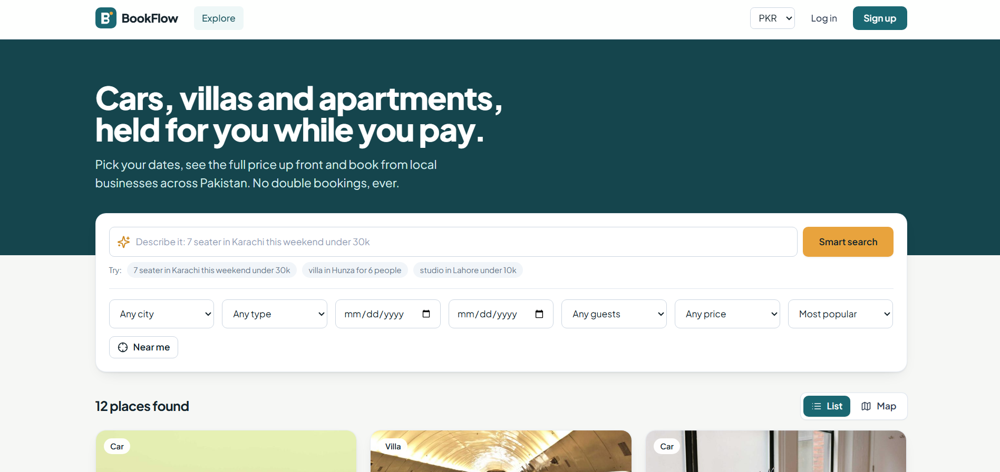
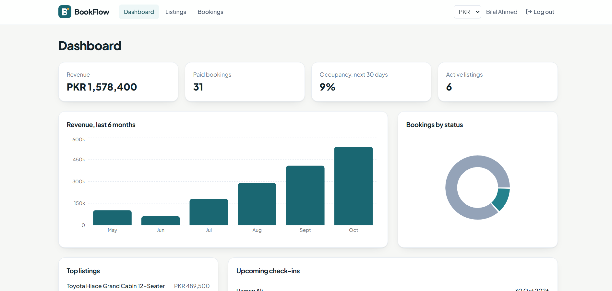

# BookFlow: Multi-Tenant Booking & Rental Platform (MERN + TypeScript)

Customers search cars, villas and apartments on a map, pick dates, pay, and manage bookings.
Businesses (tenants) manage their own listings, prices and bookings from a dashboard.
An admin watches the whole platform.

**Stack:** React 18 + TypeScript + Vite + Tailwind, Redux Toolkit, TanStack Query, Node + Express + TypeScript, MongoDB (Mongoose), JWT auth, Stripe , Leaflet maps, Recharts,  Gemini AI..


BookFlow is a full-stack booking platform for rental businesses like car rental, villas and apartments. Each business manages its own listings, prices and bookings, and customers can search, pick dates, pay and track their trips.

Live: https://bookflow-puce.vercel.app/

What it does
- Customers: search by city, type, dates, guests and price in list or map view. They see the full price (weekend and long-stay rules) before booking, their dates are held for 10 minutes while they pay, and they can cancel or leave a review.
- Business owners: a dashboard with revenue, occupancy and charts, plus listing, pricing and booking management.
- Admin: users, businesses and an audit log.

Problems I focused on
- No double bookings: every night is stored separately with a unique database index, so two people can never book the same night, even at the same moment.
- Booking states (held, confirmed, completed, cancelled, expired) with unpaid holds released automatically.
- Multi-tenant data: owners only see their own business, enforced on the server.
- Secure login: JWT access token with a refresh token in an httpOnly cookie, and role-based access.
- Photo upload: images are uploaded to Cloudinary and the app stores the image link, so pictures load fast from a CDN.

Built with React, TypeScript, Node.js, Express, MongoDB, Redux Toolkit, TanStack Query, Tailwind CSS, Stripe, Leaflet maps and Gemini AI search. Hosted on Vercel, Railway and MongoDB Atlas.

### Demo logins

| Role | Email | Password |
|---|---|---|
| Customer | demo@bookflow.dev | Demo@123 |
| Business owner | owner@bookflow.dev | Owner@123 |
| Business owner 2 | hunza@bookflow.dev | Owner@123 |
| Admin | admin@bookflow.dev | Admin@123 |

## Screenshots





.......................


# BookFlow

A booking platform for rental businesses. Car rental companies, villa owners and apartment hosts each get their own dashboard, and customers can search, pick dates, pay and manage their trips.

I built it to practise the problems real booking sites deal with: two people trying to book the same dates, payments that must not be lost, and businesses that should never see each other's data.

**Live demo:** [add your link here]
**Demo logins** are in the table below, so you can try every role without signing up.


---

## Try it in 2 minutes

Open the live demo and use the one-click buttons on the login page, or type these in.

| Role | Email | Password | What you will see |
|---|---|---|---|
| Customer | demo@bookflow.dev | Demo@123 | Search, book, pay, review |
| Business owner | owner@bookflow.dev | Owner@123 | Dashboard, listings, bookings (Karachi Car Rentals) |
| Business owner 2 | hunza@bookflow.dev | Owner@123 | A different business with its own data (Northern Escapes) |
| Admin | admin@bookflow.dev | Admin@123 | Users, businesses, activity log |

The first page load can take about 30 seconds, because the free server goes to sleep when nobody uses it.

Payments run in test mode. No real money moves.

---

## The three roles

### Customer

Someone who wants to rent a car or a place to stay.

- Searches by city, type (car, villa, apartment, studio), dates, number of guests and price
- Sees results as a list or on a map
- Can type a normal sentence like *"7 seater in Karachi this weekend under 30k"* and the search fills in the filters
- Sees the full price before booking, including weekend prices and long-stay discounts
- Reserves the dates, which are held for 10 minutes while they pay
- Pays at checkout (test mode)
- Sees all trips in **My bookings**, can cancel, and can leave a review once the stay is over
- Can view prices in PKR, USD, EUR, GBP or AED (shown as an estimate)

### Business owner

Someone who rents things out. Each owner has a business, and sees only that business's data.

- A dashboard with revenue, number of paid bookings, occupancy for the next 30 days, a revenue chart, bookings by status, top listings and upcoming check-ins
- Adds, edits, hides and deletes listings, with photo upload
- Sets pricing rules: base price per night, a weekend price increase, and a discount for stays of 7 nights or more
- Sees every booking for the business and can cancel one

### Admin

The person running the whole platform.

- Overview numbers: users, businesses, listings, bookings and total revenue
- A list of all users and all businesses
- An activity log showing who did what and when (bookings, payments, cancellations, listing changes)

---

## Screens

**Customer**

| Screen | What it does |
|---|---|
| Home | Search box, filters, list and map view |
| Listing page | Photos, description, availability calendar, price breakdown, map, reviews |
| Checkout | 10-minute countdown and payment |
| My bookings | Upcoming, past and cancelled trips, plus reviews |


**Business owner**

| Screen | What it does |
|---|---|
| Dashboard | Revenue, occupancy, charts, upcoming check-ins |
| Listings | All of the business's listings, switch on or off, edit, delete |
| Add or edit listing | Details, pricing rules, location and photo upload |
| Bookings | Every booking, with a status filter and cancel |


**Admin**

| Screen | What it does |
|---|---|
| Admin panel | Overview, users, businesses and the activity log |


---

## The interesting parts

These are the things I spent the most time on.

**1. No double bookings.**
Every booked night is saved as its own record, and the database has a unique rule on listing plus date. If two people click Reserve for the same night at the same second, the database accepts one and rejects the other. I did not rely on checking first and saving second, because that can fail when two requests arrive together.

**2. Holding dates while paying.**
When a customer picks dates, they get a booking in a "held" state for 10 minutes. A background job runs every minute and frees any hold that was not paid.

**3. A booking has clear states.**
Held, confirmed, completed, cancelled, expired. A booking can only move along allowed paths. For example, a cancelled booking can never become confirmed. This is written in one small file and covered by tests.

**4. Businesses stay separate.**
Each owner belongs to one business. The server checks this on every request, not just in the screens. An owner cannot read or change another business's listings or bookings, even by calling the API directly.

**5. Safer login.**
The short-lived access token stays in memory. The longer-lived refresh token sits in an httpOnly cookie, which JavaScript cannot read. Logging out cancels old refresh tokens. Every page and API route also checks the user's role.

**6. Pricing is plain, testable code.**
The price comes from one function with no database calls: nights times the base price, plus the weekend increase, minus the long-stay discount. It has tests.

---

## What it is built with

| Part | Tools |
|---|---|
| Frontend | React 18, TypeScript, Vite, Tailwind CSS, React Router |
| State and data | Redux Toolkit, TanStack Query, Axios |
| Backend | Node.js, Express, TypeScript |
| Database | MongoDB with Mongoose |
| Security | JWT, bcrypt, Helmet, rate limiting, Zod validation |
| Extras | Stripe (test mode), Leaflet maps, Recharts, Cloudinary photo upload, optional Gemini search |
| Testing and tools | Vitest, GitHub Actions, Docker |
| Hosting (all free) | Vercel, Render, MongoDB Atlas |

---

## Run it on your own computer

You need Node.js 18.18 or newer and a MongoDB database (a free Atlas cluster works).

```bash
npm install
cp server/.env.example server/.env     # on Windows: copy server\.env.example server\.env
# open server/.env and fill in MONGODB_URI and two long random secrets
npm run seed                            # creates demo businesses, listings and bookings
npm run dev                             # website on http://localhost:5173, API on :5000
```

Optional settings (all free):

- **Stripe test payments:** add your `sk_test_` key to `STRIPE_SECRET_KEY` in `server/.env`. Without it, the app uses a built-in test payment form.
- **Smarter search:** add a free Gemini key to `GEMINI_API_KEY`. Without it, a simple rule-based search handles sentences.
- **Photo upload:** create `client/.env` with `VITE_CLOUDINARY_CLOUD_NAME` and `VITE_CLOUDINARY_UPLOAD_PRESET` (an unsigned preset from a free Cloudinary account). Without it, owners can paste image links instead.

Run the tests with `npm test`.

---

## How the code is organised

```
server/src/
  modules/     one folder per feature (auth, listings, bookings, reviews, dashboard, admin ...)
  services/    the business rules (pricing, booking states, booking logic, payments)
  models/      the database shapes
  middleware/  login checks, role checks, error handling
  jobs/        the background job that frees unpaid holds
client/src/
  pages/       one file per screen
  components/  reusable pieces (buttons, calendar, listing card, map ...)
  api/         every call to the server in one place
  store/       Redux slices (login, currency, booking draft)
```

A request travels like this: route, then controller, then service, then model. Routes say which URL, controllers handle the request, services hold the rules, and models describe the data.

---

## What it does not have yet

Being clear about this, so nobody is surprised:

- Refunds are not automated when a booking is cancelled
- No email notifications
- No Google login
- It uses MongoDB only. For a much bigger system I would look at a queue such as BullMQ with Redis for background work
- Photo upload goes straight from the browser to Cloudinary with an unsigned preset. A larger system should sign each upload on the server
- The test coverage is small (pricing and booking states). End-to-end tests would be the next addition

---

## About me

I am [your name], a MERN stack developer. I built BookFlow to show how I handle real-world problems, not just screens.

- LinkedIn: [your link]
- Email: [your email]
- Other projects: [your links]

Photos are from Unsplash and Pexels.
